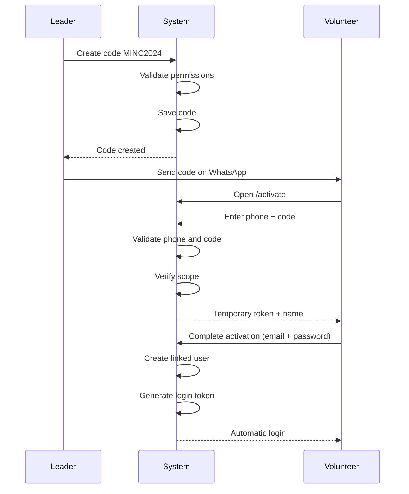

# Usage Guide: Bulk Onboarding via Access Code

## 📋 Overview

This system lets leaders create shared access codes to activate volunteer accounts in bulk, removing the need for SMS or individual invites.

## 👥 For Leaders (Create Codes)

### Step 1: Open the Access Codes Page

1. Log in to the system
2. Go to **"Access Codes"** in the menu (or open `/access-codes`)
3. You will see:
   - List of codes you created
   - Statistics (active codes, expired, total activations)
   - **"Create New Code"** button

### Step 2: Create a Code

1. Click **"Create New Code"**
2. Fill in the form:
   - **Code**: Enter a unique code (e.g. `MINC2024`, `BOASVINDAS2024`)
     - Uppercase letters and numbers only
     - Minimum 4 characters
   - **Scope type**: Choose one of:
     - **Church**: Valid for the whole church
     - **Ministry**: Valid for a specific ministry
     - **Team**: Valid for a specific team
   - **Select scope**: Pick the church, ministry, or team for the selected type
   - **Validity (days)**: How long the code stays valid (default: 30 days)
   - **Usage limit** (optional): How many people may use the code (leave empty for unlimited)
3. Click **"Create Code"**

### Step 3: Share the Code

1. Copy the created code
2. Send a single message in the church/team WhatsApp group:
   ```
   Everyone, our system is live! 🎉
   
   To activate your account:
   1. Go to: [SYSTEM_URL]/activate
   2. Enter your registered phone number
   3. Enter the code: MINC2024
   
   Questions? Message me!
   ```

### Step 4: Track Activations

- On the Access Codes page you can see:
  - How many times each code was used
  - Status (active/expired/deactivated)
  - Expiration date
- To deactivate a code early, click **"Deactivate"**

## 👤 For Volunteers (Activate Account)

### Step 1: Open the Activation Page

1. Go to: `[SYSTEM_URL]/activate`
2. You will see a form with two fields:
   - Phone
   - Access code

### Step 2: Verify Details

1. Enter your **phone** (with area code)
   - The system applies masking automatically
   - Example: `(11) 98765-4321`
2. Enter the **access code** from your leader
   - Example: `MINC2024`
   - The code is uppercased automatically
3. Click **"Verify"**

### Step 3: Complete Activation

If the data is correct, you are redirected to complete activation:

1. You will see: **"Hello, [Your Name]!"**
2. Fill in:
   - **Email**: Your personal email (used for login)
   - **Password**: Create a secure password (minimum 6 characters)
   - **Confirm password**: Re-enter the password
3. Click **"Activate Account"**

### Step 4: Automatic Login

After activation you are logged in automatically and redirected to the dashboard.

## 🔐 Permissions

### Who can create codes?

- **Admin/Pastor**: Any scope (church, ministry, or team)
- **Ministry leader**: Codes for:
  - Their ministry
  - Teams in their ministry
- **Team leader**: Codes only for their team

## ⚠️ Validations and Rules

### System validations

1. **Phone must exist in the database**
   - Phone must have been imported beforehand
   - Format is normalized automatically

2. **Code must be valid**
   - Code exists
   - Code is active
   - Code has not expired
   - Code has not hit usage limit (if set)

3. **Person must belong to scope**
   - Team code → person linked to that team
   - Ministry code → person linked to that ministry
   - Church code → person linked to a ministry in that church

4. **Person must not already have an activated account**

5. **Email must be unique**

### Security limits

- **Rate limiting**: Max 5 activation attempts per minute per IP
- **Temporary token**: Valid 24 hours after verification
- **Single-use token**: Each token can be used once

## 📊 Usage Examples

### Example 1: Code for a Specific Team

**Scenario**: Leader activates only "Welcome Team" members

1. Create code with:
   - Code: `BOASVINDAS2024`
   - Scope: Team
   - Team: "Welcome Team"
   - Validity: 30 days
   - Limit: Unlimited

2. Share only with Welcome Team members

### Example 2: Ministry Code

**Scenario**: Leader activates all Music Ministry members

1. Create code with:
   - Code: `MUSICA2024`
   - Scope: Ministry
   - Ministry: "Music Ministry"
   - Validity: 60 days
   - Limit: 100 uses

2. Share with all ministry members

### Example 3: Whole-Church Code

**Scenario**: Pastor activates all church members

1. Create code with:
   - Code: `MINC2024`
   - Scope: Church
   - Church: "My City Church"
   - Validity: 90 days
   - Limit: Unlimited

2. Share with the whole church

## 🐛 Troubleshooting

### "Phone not found in database"

- Confirm the phone was imported correctly
- Check format (with area code)
- Contact your leader to verify you are on the list

### "Invalid access code"

- Check the code was typed correctly
- Confirm the code has not expired
- Confirm the code was not deactivated
- Contact your leader for a new code

### "You do not belong to this code's scope"

- The code targets a specific team/ministry/church
- You must be linked to that scope in the database
- Contact your leader to verify your link

### "This person already has an activated account"

- You already activated previously
- Try logging in with email and password
- Use "Forgot password" if needed

### "Email already in use"

- Try another email
- If you already have an account, log in normally

## 📝 Important Notes

1. **Prior import**: People must be imported before using a code
2. **Unique phone**: Each person needs a unique registered phone
3. **Case-insensitive code**: Code may be typed in upper or lower case
4. **Automatic expiration**: Codes expire on the defined date
5. **Manual deactivation**: Leaders can deactivate codes anytime

## 🔄 End-to-end flow



## 📞 Support

If you have questions or problems:
1. Check this guide
2. Contact your team/ministry leader
3. Contact the system administrator
