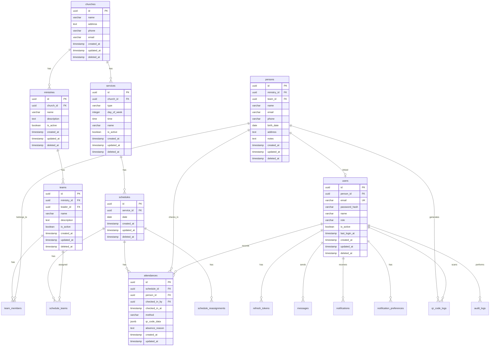

# PostgreSQL Database Schema - MINC Teams

## 📋 Overview

This document fully describes the PostgreSQL database schema for the MINC Teams system. It includes all tables, fields, relationships, constraints, indexes, and migration strategies required for implementation.

**Version**: 1.0.0  
**Last updated**: 2025-01-04  
**Database**: PostgreSQL 14+

---

## 🗺️ Entity-Relationship Diagram



---

## 📊 Main Tables

### 1. Authentication and Users

#### 1.1. `users` - System Users

Stores system users with their credentials and roles.

```sql
CREATE TABLE users (
  id UUID PRIMARY KEY DEFAULT gen_random_uuid(),
  person_id UUID REFERENCES persons(id) ON DELETE SET NULL,
  email VARCHAR(255) NOT NULL UNIQUE,
  password_hash VARCHAR(255) NOT NULL,
  name VARCHAR(255) NOT NULL,
  role VARCHAR(20) NOT NULL CHECK (role IN ('admin', 'coordinator', 'leader', 'member')),
  is_active BOOLEAN NOT NULL DEFAULT true,
  last_login_at TIMESTAMP,
  created_at TIMESTAMP NOT NULL DEFAULT NOW(),
  updated_at TIMESTAMP NOT NULL DEFAULT NOW(),
  deleted_at TIMESTAMP,
  
  CONSTRAINT fk_user_person FOREIGN KEY (person_id) REFERENCES persons(id) ON DELETE SET NULL
);

CREATE INDEX idx_users_email ON users(email) WHERE deleted_at IS NULL;
CREATE INDEX idx_users_person_id ON users(person_id) WHERE deleted_at IS NULL;
CREATE INDEX idx_users_role ON users(role) WHERE deleted_at IS NULL;
CREATE INDEX idx_users_deleted_at ON users(deleted_at) WHERE deleted_at IS NULL;
```

**Fields:**
- `id`: Unique UUID for the user
- `person_id`: Optional reference to linked volunteer/person
- `email`: Unique email of the user (used for login)
- `password_hash`: Password hash (bcrypt)
- `name`: User full name
- `role`: User role (admin, coordinator, leader, member)
- `is_active`: Whether the user is active
- `last_login_at`: Last login date/time
- `created_at`: Date of creation
- `updated_at`: Last updated date
- `deleted_at`: Soft delete

#### 1.2. `refresh_tokens` - Refresh Tokens

Stores tokens de refresh for JWT authentication renewal.

```sql
CREATE TABLE refresh_tokens (
  id UUID PRIMARY KEY DEFAULT gen_random_uuid(),
  user_id UUID NOT NULL REFERENCES users(id) ON DELETE CASCADE,
  token VARCHAR(500) NOT NULL UNIQUE,
  expires_at TIMESTAMP NOT NULL,
  is_revoked BOOLEAN NOT NULL DEFAULT false,
  created_at TIMESTAMP NOT NULL DEFAULT NOW(),
  
  CONSTRAINT fk_refresh_token_user FOREIGN KEY (user_id) REFERENCES users(id) ON DELETE CASCADE
);

CREATE INDEX idx_refresh_tokens_user_id ON refresh_tokens(user_id);
CREATE INDEX idx_refresh_tokens_token ON refresh_tokens(token);
CREATE INDEX idx_refresh_tokens_expires_at ON refresh_tokens(expires_at);
```

**Fields:**
- `id`: Unique UUID for the token
- `user_id`: Reference to user
- `token`: Refresh token (hashed)
- `expires_at`: Expiration date
- `is_revoked`: Whether the token was revoked
- `created_at`: Date of creation

#### 1.3. `password_reset_tokens` - Password Recovery Tokens

Stores temporary tokens for password recovery.

```sql
CREATE TABLE password_reset_tokens (
  id UUID PRIMARY KEY DEFAULT gen_random_uuid(),
  user_id UUID NOT NULL REFERENCES users(id) ON DELETE CASCADE,
  token VARCHAR(255) NOT NULL UNIQUE,
  expires_at TIMESTAMP NOT NULL,
  used_at TIMESTAMP,
  created_at TIMESTAMP NOT NULL DEFAULT NOW(),
  
  CONSTRAINT fk_password_reset_user FOREIGN KEY (user_id) REFERENCES users(id) ON DELETE CASCADE
);

CREATE INDEX idx_password_reset_tokens_user_id ON password_reset_tokens(user_id);
CREATE INDEX idx_password_reset_tokens_token ON password_reset_tokens(token);
CREATE INDEX idx_password_reset_tokens_expires_at ON password_reset_tokens(expires_at);
```

---

### 2. Organizational Hierarchy

#### 2.1. `churches` - Churches

Stores the churchs of the sistema.

```sql
CREATE TABLE churches (
  id UUID PRIMARY KEY DEFAULT gen_random_uuid(),
  name VARCHAR(255) NOT NULL,
  address TEXT,
  phone VARCHAR(20),
  email VARCHAR(255),
  created_at TIMESTAMP NOT NULL DEFAULT NOW(),
  updated_at TIMESTAMP NOT NULL DEFAULT NOW(),
  deleted_at TIMESTAMP
);

CREATE INDEX idx_churches_name ON churches(name) WHERE deleted_at IS NULL;
CREATE INDEX idx_churches_deleted_at ON churches(deleted_at) WHERE deleted_at IS NULL;
```

**Fields:**
- `id`: Unique UUID for the church
- `name`: Name of the church
- `address`: Full address
- `phone`: Contact phone
- `email`: Contact email
- `created_at`: Date of creation
- `updated_at`: Last updated date
- `deleted_at`: Soft delete

#### 2.2. `ministries` - Times/Ministries

Stores the ministries de cado church.

```sql
CREATE TABLE ministries (
  id UUID PRIMARY KEY DEFAULT gen_random_uuid(),
  church_id UUID NOT NULL REFERENCES churches(id) ON DELETE CASCADE,
  name VARCHAR(255) NOT NULL,
  description TEXT,
  is_active BOOLEAN NOT NULL DEFAULT true,
  created_at TIMESTAMP NOT NULL DEFAULT NOW(),
  updated_at TIMESTAMP NOT NULL DEFAULT NOW(),
  deleted_at TIMESTAMP,
  
  CONSTRAINT fk_ministry_church FOREIGN KEY (church_id) REFERENCES churches(id) ON DELETE CASCADE
);

CREATE INDEX idx_ministries_church_id ON ministries(church_id) WHERE deleted_at IS NULL;
CREATE INDEX idx_ministries_name ON ministries(name) WHERE deleted_at IS NULL;
CREATE INDEX idx_ministries_is_active ON ministries(is_active) WHERE deleted_at IS NULL;
CREATE INDEX idx_ministries_deleted_at ON ministries(deleted_at) WHERE deleted_at IS NULL;
```

**Fields:**
- `id`: Unique UUID for the ministry
- `church_id`: Reference to church
- `name`: Name of the ministry
- `description`: Description of the ministry
- `is_active`: Whether the ministry is active
- `created_at`: Date of creation
- `updated_at`: Last updated date
- `deleted_at`: Soft delete

#### 2.3. `teams` - Teams

Stores the teams de cado ministry.

```sql
CREATE TABLE teams (
  id UUID PRIMARY KEY DEFAULT gen_random_uuid(),
  ministry_id UUID NOT NULL REFERENCES ministries(id) ON DELETE CASCADE,
  leader_id UUID REFERENCES users(id) ON DELETE SET NULL,
  name VARCHAR(255) NOT NULL,
  description TEXT,
  is_active BOOLEAN NOT NULL DEFAULT true,
  created_at TIMESTAMP NOT NULL DEFAULT NOW(),
  updated_at TIMESTAMP NOT NULL DEFAULT NOW(),
  deleted_at TIMESTAMP,
  
  CONSTRAINT fk_team_ministry FOREIGN KEY (ministry_id) REFERENCES ministries(id) ON DELETE CASCADE,
  CONSTRAINT fk_team_leader FOREIGN KEY (leader_id) REFERENCES users(id) ON DELETE SET NULL
);

CREATE INDEX idx_teams_ministry_id ON teams(ministry_id) WHERE deleted_at IS NULL;
CREATE INDEX idx_teams_leader_id ON teams(leader_id) WHERE deleted_at IS NULL;
CREATE INDEX idx_teams_name ON teams(name) WHERE deleted_at IS NULL;
CREATE INDEX idx_teams_is_active ON teams(is_active) WHERE deleted_at IS NULL;
CREATE INDEX idx_teams_deleted_at ON teams(deleted_at) WHERE deleted_at IS NULL;
```

**Fields:**
- `id`: Unique team UUID
- `ministry_id`: Reference to ministry
- `leader_id`: Reference to team leader (user)
- `name`: Name of the team
- `description`: Description of the team
- `is_active`: Whether the team is active
- `created_at`: Date of creation
- `updated_at`: Last updated date
- `deleted_at`: Soft delete

#### 2.4. `persons` - Volunteers/Persons

Stores the volunteers/persons of the sistema.

```sql
CREATE TABLE persons (
  id UUID PRIMARY KEY DEFAULT gen_random_uuid(),
  ministry_id UUID REFERENCES ministries(id) ON DELETE SET NULL,
  team_id UUID REFERENCES teams(id) ON DELETE SET NULL,
  name VARCHAR(255) NOT NULL,
  email VARCHAR(255),
  phone VARCHAR(20),
  birth_date DATE,
  address TEXT,
  notes TEXT,
  created_at TIMESTAMP NOT NULL DEFAULT NOW(),
  updated_at TIMESTAMP NOT NULL DEFAULT NOW(),
  deleted_at TIMESTAMP,
  
  CONSTRAINT fk_person_ministry FOREIGN KEY (ministry_id) REFERENCES ministries(id) ON DELETE SET NULL,
  CONSTRAINT fk_person_team FOREIGN KEY (team_id) REFERENCES teams(id) ON DELETE SET NULL
);

CREATE INDEX idx_persons_ministry_id ON persons(ministry_id) WHERE deleted_at IS NULL;
CREATE INDEX idx_persons_team_id ON persons(team_id) WHERE deleted_at IS NULL;
CREATE INDEX idx_persons_name ON persons(name) WHERE deleted_at IS NULL;
CREATE INDEX idx_persons_email ON persons(email) WHERE deleted_at IS NULL;
CREATE INDEX idx_persons_deleted_at ON persons(deleted_at) WHERE deleted_at IS NULL;
```

**Fields:**
- `id`: Unique person UUID
- `ministry_id`: Reference to ministry (optional)
- `team_id`: Reference to team (optional)
- `name`: Nome completo
- `email`: Contact email
- `phone`: Contact phone
- `birth_date`: Birth date
- `address`: Full address
- `notes`: General notes
- `created_at`: Date of creation
- `updated_at`: Last updated date
- `deleted_at`: Soft delete

#### 2.5. `team_members` - Team Members (N:N)

Relationship table N:N between teams and persons.

```sql
CREATE TABLE team_members (
  id UUID PRIMARY KEY DEFAULT gen_random_uuid(),
  team_id UUID NOT NULL REFERENCES teams(id) ON DELETE CASCADE,
  person_id UUID NOT NULL REFERENCES persons(id) ON DELETE CASCADE,
  created_at TIMESTAMP NOT NULL DEFAULT NOW(),
  
  CONSTRAINT fk_team_member_team FOREIGN KEY (team_id) REFERENCES teams(id) ON DELETE CASCADE,
  CONSTRAINT fk_team_member_person FOREIGN KEY (person_id) REFERENCES persons(id) ON DELETE CASCADE,
  CONSTRAINT uk_team_member UNIQUE (team_id, person_id)
);

CREATE INDEX idx_team_members_team_id ON team_members(team_id);
CREATE INDEX idx_team_members_person_id ON team_members(person_id);
```

**Fields:**
- `id`: Unique UUID for the relationship
- `team_id`: Reference to team
- `person_id`: Reference to person
- `created_at`: Date of creation

---

### 3. Worship Services and Schedules

#### 3.1. `services` - Worship Services/Services

Stores the worship services/services de cado church.

```sql
CREATE TYPE service_type AS ENUM (
  'sunday_morning',
  'sunday_evening',
  'wednesday',
  'friday',
  'special'
);

CREATE TABLE services (
  id UUID PRIMARY KEY DEFAULT gen_random_uuid(),
  church_id UUID NOT NULL REFERENCES churches(id) ON DELETE CASCADE,
  type service_type NOT NULL,
  day_of_week INTEGER NOT NULL CHECK (day_of_week >= 0 AND day_of_week <= 6),
  time TIME NOT NULL,
  name VARCHAR(255) NOT NULL,
  is_active BOOLEAN NOT NULL DEFAULT true,
  created_at TIMESTAMP NOT NULL DEFAULT NOW(),
  updated_at TIMESTAMP NOT NULL DEFAULT NOW(),
  deleted_at TIMESTAMP,
  
  CONSTRAINT fk_service_church FOREIGN KEY (church_id) REFERENCES churches(id) ON DELETE CASCADE
);

CREATE INDEX idx_services_church_id ON services(church_id) WHERE deleted_at IS NULL;
CREATE INDEX idx_services_type ON services(type) WHERE deleted_at IS NULL;
CREATE INDEX idx_services_day_of_week ON services(day_of_week) WHERE deleted_at IS NULL;
CREATE INDEX idx_services_is_active ON services(is_active) WHERE deleted_at IS NULL;
CREATE INDEX idx_services_deleted_at ON services(deleted_at) WHERE deleted_at IS NULL;
```

**Fields:**
- `id`: Unique UUID for the worship service
- `church_id`: Reference to church
- `type`: Type of worship service (enum)
- `day_of_week`: Day of week (0=Sunday, 6=Saturday)
- `time`: Worship service time
- `name`: Name of the worship service
- `is_active`: Se o worship service is active
- `created_at`: Date of creation
- `updated_at`: Last updated date
- `deleted_at`: Soft delete

#### 3.2. `schedules` - Schedules

Stores the schedules de worship services.

```sql
CREATE TABLE schedules (
  id UUID PRIMARY KEY DEFAULT gen_random_uuid(),
  service_id UUID NOT NULL REFERENCES services(id) ON DELETE CASCADE,
  date DATE NOT NULL,
  created_at TIMESTAMP NOT NULL DEFAULT NOW(),
  updated_at TIMESTAMP NOT NULL DEFAULT NOW(),
  deleted_at TIMESTAMP,
  
  CONSTRAINT fk_schedule_service FOREIGN KEY (service_id) REFERENCES services(id) ON DELETE CASCADE,
  CONSTRAINT uk_schedule_service_date UNIQUE (service_id, date) WHERE deleted_at IS NULL
);

CREATE INDEX idx_schedules_service_id ON schedules(service_id) WHERE deleted_at IS NULL;
CREATE INDEX idx_schedules_date ON schedules(date) WHERE deleted_at IS NULL;
CREATE INDEX idx_schedules_deleted_at ON schedules(deleted_at) WHERE deleted_at IS NULL;
```

**Fields:**
- `id`: Unique schedule UUID
- `service_id`: Reference to worship service
- `date`: Date of the schedule
- `created_at`: Date of creation
- `updated_at`: Last updated date
- `deleted_at`: Soft delete

#### 3.3. `schedule_teams` - Teams Assigned to Schedules (N:N)

Relationship table N:N between schedules and teams.

```sql
CREATE TABLE schedule_teams (
  id UUID PRIMARY KEY DEFAULT gen_random_uuid(),
  schedule_id UUID NOT NULL REFERENCES schedules(id) ON DELETE CASCADE,
  team_id UUID NOT NULL REFERENCES teams(id) ON DELETE CASCADE,
  created_at TIMESTAMP NOT NULL DEFAULT NOW(),
  
  CONSTRAINT fk_schedule_team_schedule FOREIGN KEY (schedule_id) REFERENCES schedules(id) ON DELETE CASCADE,
  CONSTRAINT fk_schedule_team_team FOREIGN KEY (team_id) REFERENCES teams(id) ON DELETE CASCADE,
  CONSTRAINT uk_schedule_team UNIQUE (schedule_id, team_id)
);

CREATE INDEX idx_schedule_teams_schedule_id ON schedule_teams(schedule_id);
CREATE INDEX idx_schedule_teams_team_id ON schedule_teams(team_id);
```

**Fields:**
- `id`: Unique UUID for the relationship
- `schedule_id`: Reference to schedule
- `team_id`: Reference to team
- `created_at`: Date of creation

#### 3.4. `attendances` - Check-ins/Attendances

Stores the check-ins of the volunteers nas schedules.

```sql
CREATE TYPE attendance_method AS ENUM ('qr_code', 'manual');

CREATE TABLE attendances (
  id UUID PRIMARY KEY DEFAULT gen_random_uuid(),
  schedule_id UUID NOT NULL REFERENCES schedules(id) ON DELETE CASCADE,
  person_id UUID NOT NULL REFERENCES persons(id) ON DELETE CASCADE,
  checked_in_by UUID NOT NULL REFERENCES users(id) ON DELETE RESTRICT,
  checked_in_at TIMESTAMP NOT NULL DEFAULT NOW(),
  method attendance_method NOT NULL,
  qr_code_data JSONB,
  absence_reason TEXT,
  created_at TIMESTAMP NOT NULL DEFAULT NOW(),
  updated_at TIMESTAMP NOT NULL DEFAULT NOW(),
  
  CONSTRAINT fk_attendance_schedule FOREIGN KEY (schedule_id) REFERENCES schedules(id) ON DELETE CASCADE,
  CONSTRAINT fk_attendance_person FOREIGN KEY (person_id) REFERENCES persons(id) ON DELETE CASCADE,
  CONSTRAINT fk_attendance_checked_por FOREIGN KEY (checked_in_by) REFERENCES users(id) ON DELETE RESTRICT,
  CONSTRAINT uk_attendance_schedule_person UNIQUE (schedule_id, person_id)
);

CREATE INDEX idx_attendances_schedule_id ON attendances(schedule_id);
CREATE INDEX idx_attendances_person_id ON attendances(person_id);
CREATE INDEX idx_attendances_checked_in_by ON attendances(checked_in_by);
CREATE INDEX idx_attendances_checked_in_at ON attendances(checked_in_at);
CREATE INDEX idx_attendances_method ON attendances(method);
```

**Fields:**
- `id`: Unique UUID for the check-in
- `schedule_id`: Reference to schedule
- `person_id`: Reference to volunteer who checked in
- `checked_in_by`: Reference to user who recorded the check-in (leader)
- `checked_in_at`: Data/hora of the check-in
- `method`: Check-in method (qr_code or manual)
- `qr_code_data`: QR code data used (if method is qr_code)
- `absence_reason`: Absence justification (if absent)
- `created_at`: Date of creation
- `updated_at`: Last updated date

#### 3.5. `schedule_reassignments` - Reassignments

Stores reassignment history for volunteers between teams.

```sql
CREATE TABLE schedule_reassignments (
  id UUID PRIMARY KEY DEFAULT gen_random_uuid(),
  schedule_id UUID NOT NULL REFERENCES schedules(id) ON DELETE CASCADE,
  from_team_id UUID NOT NULL REFERENCES teams(id) ON DELETE RESTRICT,
  to_team_id UUID NOT NULL REFERENCES teams(id) ON DELETE RESTRICT,
  person_id UUID NOT NULL REFERENCES persons(id) ON DELETE CASCADE,
  reason TEXT,
  created_por UUID NOT NULL REFERENCES users(id) ON DELETE RESTRICT,
  created_at TIMESTAMP NOT NULL DEFAULT NOW(),
  
  CONSTRAINT fk_reassignment_schedule FOREIGN KEY (schedule_id) REFERENCES schedules(id) ON DELETE CASCADE,
  CONSTRAINT fk_reassignment_from_team FOREIGN KEY (from_team_id) REFERENCES teams(id) ON DELETE RESTRICT,
  CONSTRAINT fk_reassignment_to_team FOREIGN KEY (to_team_id) REFERENCES teams(id) ON DELETE RESTRICT,
  CONSTRAINT fk_reassignment_person FOREIGN KEY (person_id) REFERENCES persons(id) ON DELETE CASCADE,
  CONSTRAINT fk_reassignment_created_por FOREIGN KEY (created_by) REFERENCES users(id) ON DELETE RESTRICT
);

CREATE INDEX idx_schedule_reassignments_schedule_id ON schedule_reassignments(schedule_id);
CREATE INDEX idx_schedule_reassignments_person_id ON schedule_reassignments(person_id);
CREATE INDEX idx_schedule_reassignments_created_por ON schedule_reassignments(created_by);
CREATE INDEX idx_schedule_reassignments_created_at ON schedule_reassignments(created_at);
```

**Fields:**
- `id`: Unique UUID for the reassignment
- `schedule_id`: Reference to schedule
- `from_team_id`: Source team
- `to_team_id`: Destination team
- `person_id`: Reassigned volunteer
- `reason`: Reassignment reason
- `created_by`: User who performed the reassignment
- `created_at`: Date of creation

---

### 4. QR Code and Check-in

#### 4.1. `qr_code_logs` - QR Code Logs

Stores logs of all QR code validation attempts for auditing.

```sql
CREATE TABLE qr_code_logs (
  id UUID PRIMARY KEY DEFAULT gen_random_uuid(),
  person_id UUID NOT NULL REFERENCES persons(id) ON DELETE CASCADE,
  scanned_por UUID NOT NULL REFERENCES users(id) ON DELETE RESTRICT,
  qr_code_data JSONB NOT NULL,
  scanned_at TIMESTAMP NOT NULL DEFAULT NOW(),
  is_valid BOOLEAN NOT NULL,
  validation_error TEXT,
  created_at TIMESTAMP NOT NULL DEFAULT NOW(),
  
  CONSTRAINT fk_qr_log_person FOREIGN KEY (person_id) REFERENCES persons(id) ON DELETE CASCADE,
  CONSTRAINT fk_qr_log_scanned_por FOREIGN KEY (scanned_by) REFERENCES users(id) ON DELETE RESTRICT
);

CREATE INDEX idx_qr_code_logs_person_id ON qr_code_logs(person_id);
CREATE INDEX idx_qr_code_logs_scanned_por ON qr_code_logs(scanned_by);
CREATE INDEX idx_qr_code_logs_scanned_at ON qr_code_logs(scanned_at);
CREATE INDEX idx_qr_code_logs_is_valid ON qr_code_logs(is_valid);
```

**Fields:**
- `id`: Unique UUID for the log
- `person_id`: Reference to volunteer
- `scanned_by`: User who scanned the QR code
- `qr_code_data`: Full scanned QR code payload
- `scanned_at`: Scan date/time
- `is_valid`: Whether validation succeeded
- `validation_error`: Error message (if invalid)
- `created_at`: Date of creation

---

### 5. Communication

#### 5.1. `messages` - Messages

Stores messages enviado pelo sistema.

```sql
CREATE TYPE message_segment_type AS ENUM ('ministry', 'team', 'person', 'all');

CREATE TABLE messages (
  id UUID PRIMARY KEY DEFAULT gen_random_uuid(),
  sender_id UUID NOT NULL REFERENCES users(id) ON DELETE RESTRICT,
  title VARCHAR(255) NOT NULL,
  content TEXT NOT NULL,
  segment_type message_segment_type NOT NULL,
  segment_id UUID,
  scheduled_at TIMESTAMP,
  sent_at TIMESTAMP,
  created_at TIMESTAMP NOT NULL DEFAULT NOW(),
  
  CONSTRAINT fk_message_sender FOREIGN KEY (sender_id) REFERENCES users(id) ON DELETE RESTRICT
);

CREATE INDEX idx_messages_sender_id ON messages(sender_id);
CREATE INDEX idx_messages_segment_type ON messages(segment_type);
CREATE INDEX idx_messages_scheduled_at ON messages(scheduled_at);
CREATE INDEX idx_messages_sent_at ON messages(sent_at);
```

**Fields:**
- `id`: Unique UUID for the message
- `sender_id`: User who sent the message
- `title`: Message title
- `content`: Message content
- `segment_type`: Type of segmento (ministry, team, person, all)
- `segment_id`: Segment ID (ministry_id, team_id, person_id or NULL)
- `scheduled_at`: Scheduled send date/time
- `sent_at`: Actual send date/time
- `created_at`: Date of creation

#### 5.2. `message_recipients` - Message Recipients

Stores recipients for each message.

```sql
CREATE TABLE message_recipients (
  id UUID PRIMARY KEY DEFAULT gen_random_uuid(),
  message_id UUID NOT NULL REFERENCES messages(id) ON DELETE CASCADE,
  recipient_id UUID NOT NULL REFERENCES users(id) ON DELETE CASCADE,
  read_at TIMESTAMP,
  created_at TIMESTAMP NOT NULL DEFAULT NOW(),
  
  CONSTRAINT fk_message_recipient_message FOREIGN KEY (message_id) REFERENCES messages(id) ON DELETE CASCADE,
  CONSTRAINT fk_message_recipient_user FOREIGN KEY (recipient_id) REFERENCES users(id) ON DELETE CASCADE,
  CONSTRAINT uk_message_recipient UNIQUE (message_id, recipient_id)
);

CREATE INDEX idx_message_recipients_message_id ON message_recipients(message_id);
CREATE INDEX idx_message_recipients_recipient_id ON message_recipients(recipient_id);
CREATE INDEX idx_message_recipients_read_at ON message_recipients(read_at);
```

**Fields:**
- `id`: Unique UUID for the relationship
- `message_id`: Reference to message
- `recipient_id`: Reference to recipient (user)
- `read_at`: Read date/time
- `created_at`: Date of creation

#### 5.3. `notifications` - Push Notifications

Stores sent push notifications.

```sql
CREATE TABLE notifications (
  id UUID PRIMARY KEY DEFAULT gen_random_uuid(),
  user_id UUID NOT NULL REFERENCES users(id) ON DELETE CASCADE,
  title VARCHAR(255) NOT NULL,
  body TEXT NOT NULL,
  type VARCHAR(50) NOT NULL,
  data JSONB,
  read_at TIMESTAMP,
  created_at TIMESTAMP NOT NULL DEFAULT NOW(),
  
  CONSTRAINT fk_notification_user FOREIGN KEY (user_id) REFERENCES users(id) ON DELETE CASCADE
);

CREATE INDEX idx_notifications_user_id ON notifications(user_id);
CREATE INDEX idx_notifications_type ON notifications(type);
CREATE INDEX idx_notifications_read_at ON notifications(read_at);
CREATE INDEX idx_notifications_created_at ON notifications(created_at);
```

**Fields:**
- `id`: Unique notification UUID
- `user_id`: Reference to recipient user
- `title`: Notification title
- `body`: Notification body
- `type`: Type of the notification
- `data`: Dados adicionais (JSONB)
- `read_at`: Read date/time
- `created_at`: Date of creation

#### 5.4. `notification_preferences` - Notification Preferences

Stores notification preferences by user.

```sql
CREATE TABLE notification_preferences (
  id UUID PRIMARY KEY DEFAULT gen_random_uuid(),
  user_id UUID NOT NULL REFERENCES users(id) ON DELETE CASCADE,
  schedule_reminder BOOLEAN NOT NULL DEFAULT true,
  check_in_reminder BOOLEAN NOT NULL DEFAULT true,
  reassignment_notification BOOLEAN NOT NULL DEFAULT true,
  message_notification BOOLEAN NOT NULL DEFAULT true,
  created_at TIMESTAMP NOT NULL DEFAULT NOW(),
  updated_at TIMESTAMP NOT NULL DEFAULT NOW(),
  
  CONSTRAINT fk_notification_preference_user FOREIGN KEY (user_id) REFERENCES users(id) ON DELETE CASCADE,
  CONSTRAINT uk_notification_preference_user UNIQUE (user_id)
);

CREATE INDEX idx_notification_preferences_user_id ON notification_preferences(user_id);
```

**Fields:**
- `id`: Unique UUID for the preference
- `user_id`: Reference to user
- `schedule_reminder`: Receive schedule reminders
- `check_in_reminder`: Receive check-in reminders
- `reassignment_notification`: Receive reassignment notifications
- `message_notification`: Receive message notifications
- `created_at`: Date of creation
- `updated_at`: Last updated date

---

### 6. Auditing and Logs

#### 6.1. `audit_logs` - Audit Logs

Stores logs of critical actions for auditing and compliance.

```sql
CREATE TYPE audit_action AS ENUM (
  'create',
  'update',
  'delete',
  'login',
  'logout',
  'password_change',
  'role_change',
  'reassignment',
  'check_in',
  'schedule_draw'
);

CREATE TABLE audit_logs (
  id UUID PRIMARY KEY DEFAULT gen_random_uuid(),
  user_id UUID REFERENCES users(id) ON DELETE SET NULL,
  action audit_action NOT NULL,
  entity_type VARCHAR(50) NOT NULL,
  entity_id UUID,
  old_values JSONB,
  new_values JSONB,
  ip_address VARCHAR(45),
  user_agent TEXT,
  created_at TIMESTAMP NOT NULL DEFAULT NOW(),
  
  CONSTRAINT fk_audit_log_user FOREIGN KEY (user_id) REFERENCES users(id) ON DELETE SET NULL
);

CREATE INDEX idx_audit_logs_user_id ON audit_logs(user_id);
CREATE INDEX idx_audit_logs_action ON audit_logs(action);
CREATE INDEX idx_audit_logs_entity_type ON audit_logs(entity_type);
CREATE INDEX idx_audit_logs_entity_id ON audit_logs(entity_id);
CREATE INDEX idx_audit_logs_created_at ON audit_logs(created_at);
```

**Fields:**
- `id`: Unique UUID for the log
- `user_id`: User who performed the action
- `action`: Type of action executed
- `entity_type`: Type of the entidade afetada
- `entity_id`: ID of affected entity
- `old_values`: Old values (JSONB)
- `new_values`: New values (JSONB)
- `ip_address`: Source IP
- `user_agent`: Browser user agent
- `created_at`: Date of creation

#### 6.2. `draw_history` - Draw History

Stores automatic team draw history.

```sql
CREATE TABLE draw_history (
  id UUID PRIMARY KEY DEFAULT gen_random_uuid(),
  service_id UUID NOT NULL REFERENCES services(id) ON DELETE CASCADE,
  month INTEGER NOT NULL CHECK (month >= 1 AND month <= 12),
  year INTEGER NOT NULL CHECK (year >= 2020),
  drawn_por UUID NOT NULL REFERENCES users(id) ON DELETE RESTRICT,
  teams_data JSONB NOT NULL,
  created_at TIMESTAMP NOT NULL DEFAULT NOW(),
  
  CONSTRAINT fk_draw_history_service FOREIGN KEY (service_id) REFERENCES services(id) ON DELETE CASCADE,
  CONSTRAINT fk_draw_history_drawn_por FOREIGN KEY (drawn_by) REFERENCES users(id) ON DELETE RESTRICT,
  CONSTRAINT uk_draw_history_service_month_year UNIQUE (service_id, month, year)
);

CREATE INDEX idx_draw_history_service_id ON draw_history(service_id);
CREATE INDEX idx_draw_history_month_year ON draw_history(year, month);
CREATE INDEX idx_draw_history_drawn_por ON draw_history(drawn_by);
CREATE INDEX idx_draw_history_created_at ON draw_history(created_at);
```

**Fields:**
- `id`: Unique UUID for the draw
- `service_id`: Reference to worship service
- `month`: Month of the draw (1-12)
- `year`: Year of the draw
- `drawn_by`: User who ran the draw
- `teams_data`: Drawn teams data (JSONB) (JSONB)
- `created_at`: Date of creation

---

## 🔄 Triggers

### Automatic `updated_at` trigger

Create a function to update `updated_at` automaticamente:

```sql
CREATE OR REPLACE FUNCTION update_updated_at_column()
RETURNS TRIGGER AS $$
BEGIN
  NEW.updated_at = NOW();
  RETURN NEW;
END;
$$ LANGUAGE plpgsql;
```

Apply the trigger on all tables with `updated_at`:

```sql
-- Example for the users
CREATE TRIGGER update_users_updated_at
  BEFORE UPDATE ON users
  FOR EACH ROW
  EXECUTE FUNCTION update_updated_at_column();

-- Apply for all other tables with updated_at
-- (churches, ministries, teams, persons, services, schedules, etc.)
```

---

## 📋 Table Creation Order (Migrations)

Creation order must respect foreign key dependencies:

1. **churches** (no dependencies)
2. **ministries** (depends on churches)
3. **persons** (depends on ministries and teams, mas teams ainda not existe - create later)
4. **users** (depends on persons)
5. **teams** (depends on ministries and users)
6. **persons** (update foreign keys to teams)
7. **team_members** (depends on teams and persons)
8. **services** (depends on churches)
9. **schedules** (depends on services)
10. **schedule_teams** (depends on schedules and teams)
11. **attendances** (depends on schedules, persons and users)
12. **schedule_reassignments** (depends on schedules, teams, persons and users)
13. **refresh_tokens** (depends on users)
14. **password_reset_tokens** (depends on users)
15. **messages** (depends on users)
16. **message_recipients** (depends on messages and users)
17. **notifications** (depends on users)
18. **notification_preferences** (depends on users)
19. **qr_code_logs** (depends on persons and users)
20. **audit_logs** (depends on users)
21. **draw_history** (depends on services and users)

---

## 🔍 Additional Índicees for Performance

### Composite Índicees

```sql
-- Lookup by persons by ministry and team
CREATE INDEX idx_persons_ministry_team ON persons(ministry_id, team_id) WHERE deleted_at IS NULL;

-- Lookup by schedules by data and worship service
CREATE INDEX idx_schedules_service_date ON schedules(service_id, date) WHERE deleted_at IS NULL;

-- Lookup by check-ins by schedule and person
CREATE INDEX idx_attendances_schedule_person ON attendances(schedule_id, person_id);

-- Lookup by messages unread
CREATE INDEX idx_message_recipients_unread ON message_recipients(message_id, recipient_id) WHERE read_at IS NULL;

-- Lookup by notifications unread
CREATE INDEX idx_notifications_unread ON notifications(user_id, read_at) WHERE read_at IS NULL;
```

---

## 🔒 Security Considerations

### Soft Delete

All main tables implement soft delete via the `deleted_at`. This enables:
- Recovery of accidentally deleted data
- Complete auditing
- LGPD compliance

### Encryption

- Passwords should be hashed with bcrypt (salt rounds: 10)
- Tokens should ser hasheado before storage
- Sensitive JSONB data may be encrypted

### Validations

- Email must be unique and valid
- Phone numbers should follow the default format
- Dates must be validated
- Roles must match the enum

---

## 📊 Data Retention Policy (LGPD)

### Data to Retain

- **Logs de auditing**: 7 anos
- **QR Code Logs**: 1 ano
- **History of draws**: Indefinido
- **Messages**: 2 anos
- **Notifications**: 6 meses

### Data Deletion

Implement periodic cleanup routines:

```sql
-- Example: Excluir logs de QR Code with most de 1 ano
DELETE FROM qr_code_logs 
WHERE created_at < NOW() - INTERVAL '1 year';

-- Example: Excluir notifications lidas with most de 6 meses
DELETE FROM notifications 
WHERE read_at IS NOT NULL 
  AND read_at < NOW() - INTERVAL '6 months';
```

---

## 🚀 Next Steps

1. Create migrations using TypeORM or similar
2. Implement seeds for initial data
3. Configure automatic backups
4. Implement data cleanup routines
5. Configure performance monitoring
6. Document common queries

---

## 📝 Important Notes

- All IDs are UUIDs for better distribution and security
- Timestamps use TIMESTAMP WITH TIME ZONE when required
- Partial indexes (WHERE deleted_at IS NULL) improve performance
- Constraints enforce referential integrity
- Soft delete allows data recovery

---

**Last updated**: 2025-01-04  
**Schema version**: 1.0.0
